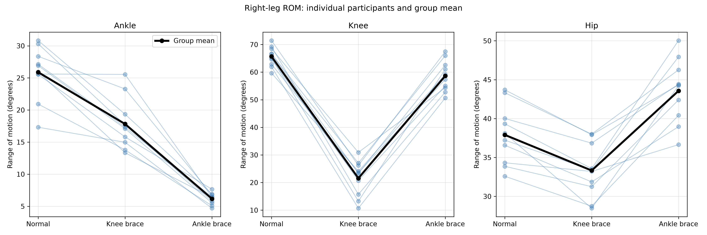

# Gait Analysis: Joint Motion During Braced Walking

Python analysis of how knee and ankle bracing relate to hip, knee,
and ankle range of motion during walking.

## Research question

How does right-leg joint range of motion differ between normal,
knee-braced, and ankle-braced walking?

## Dataset

Source: [UCI Multivariate Gait Data](https://archive.ics.uci.edu/dataset/760/multivariate+gait+data).

The dataset contains 10 healthy participants, three walking conditions,
10 cycles per condition, both legs, and three joints. Each cycle has
101 measurements representing 0–100% of the gait cycle.

Joint angles are measured in degrees. The time column represents
cycle percentage, not elapsed seconds.

This project analyzes the right leg, where the braces were worn.
The original data were collected by the dataset authors.

## Methods

1. Inspect dataset structure and missing values.
2. Plot participant 1's mean joint-angle curves across 10 cycles.
3. Calculate each cycle's range of motion: maximum minus minimum angle.
4. Average cycle ROMs within each participant, condition, and joint.
5. Visualize individual participant ROMs and group means.
6. Run six two-sided paired t-tests comparing each braced condition
   with normal walking across the 10 participants.
7. Apply Bonferroni correction across the six comparisons.
8. Inspect normal Q-Q plots of participant differences.

Participants are the units of statistical analysis.
Repeated cycles are averaged within participants.

## Results

Mean right-leg ROM across participants, in degrees:

| Joint | Normal | Knee brace | Ankle brace |
|---|---:|---:|---:|
| Ankle | 25.89 | 17.82 | 6.17 |
| Knee | 65.67 | 21.55 | 58.63 |
| Hip | 37.91 | 33.32 | 43.57 |

All six paired comparisons had Bonferroni-adjusted p-values below 0.05.

Ankle-braced walking showed a mean ankle ROM reduction of 19.71°
and hip ROM increase of 5.66° relative to normal walking.
This is consistent with a possible compensation pattern;
ROM measurements alone do not establish the mechanism.



## Limitations

- Small sample of 10 healthy participants walking on a treadmill.
- Results should not be generalized directly to clinical populations.
- Analysis focuses on right-leg ROM rather than full-body mechanics.
- Paired t-tests assume approximately normal participant differences;
  Q-Q plots provide a limited visual check with this sample size.
- Reported 95% confidence intervals are per comparison and are not
  adjusted for multiple comparisons.
- These are exploratory analyses of an existing dataset.

## Run the project

Tested with Python 3.13.7 on Windows.

Download the dataset from UCI and place gait.csv inside data/.

From the main project folder:

```bat
py -m venv .venv
.venv\Scripts\python.exe -m pip install -r requirements.txt
.venv\Scripts\python.exe scripts\analyze_gait.py
.venv\Scripts\python.exe scripts\statistics_gait.py
```

Close the analysis figure windows before running the statistics script.

Generated figures are saved in figures/ and tables in results/.

## Tools

Python, pandas, Matplotlib, and SciPy.